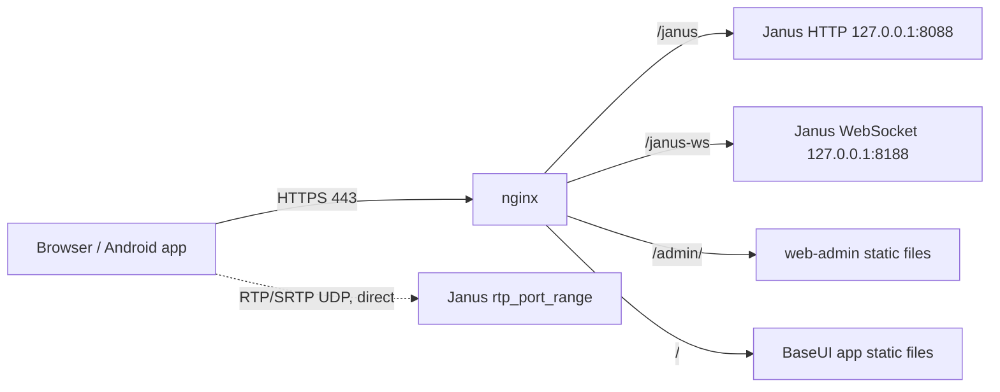

# nginx configuration (production HTTPS / WSS)

nginx terminates TLS for `webrtc.thebase.vn`, proxies the Janus APIs on loopback, and serves the static web apps published by `deploy.sh`.

## Topology



WebRTC media does not pass through nginx. Open the Janus RTP range in the firewall (the Makefile sets `20000-40000/udp`) and set `nat_1_1_mapping` / `stun_server` in `janus.jcfg` if the host is behind NAT.

## Routes

| Location | Behavior |
| --- | --- |
| `:80` | ACME challenge from `/var/www/certbot`, everything else redirects to HTTPS |
| `/janus` | Janus REST API, proxied to `127.0.0.1:8088`; buffering off, 70 s timeouts for long-poll |
| `/janus-ws` | Janus WebSocket API (`janus-protocol`), proxied to `127.0.0.1:8188`; 3600 s timeouts |
| `/admin/` | Serves web-admin from `/opt/services/sites/$host/current/web-admin/` (the Janus Admin API proxy is commented out) |
| `/` | Serves the BaseUI app from `/opt/services/sites/$host/current/app` |

`/opt/services/sites/<host>/current` is the release directory that `deploy.sh` replaces from `dist/`. It contains `app/` and `web-admin/`.

## Required Janus settings

Janus listens on loopback only; nginx handles TLS.

| File | Settings |
| --- | --- |
| `janus.transport.http.jcfg` | `http = true` (8088), `https = false`, `ip = "127.0.0.1"`; `admin_http = true` (7088) only if the Admin API is needed |
| `janus.transport.websockets.jcfg` | `ws = true` (8188), `wss = false`, `ws_ip = "127.0.0.1"` |

## Install

1. Replace `webrtc.yourweb.site` with the real domain, and check the certificate paths.
2. Copy the file and reload:

        sudo cp docs/nginx.conf /etc/nginx/conf.d/webrtc.conf
        sudo nginx -t && sudo systemctl reload nginx

3. Deploy the web apps with `./deploy.sh`.

## Things to check before use

- The config below still uses the placeholder domain `webrtc.yourweb.site`, while the log paths and Makefile defaults use `webrtc.thebase.vn`.
- Log files go to `/usr/local/apisix/logs/`; change this if APISIX is not installed.
- `X-Real-IP` on `/janus` is taken from `$http_cf_connecting_ip` (Cloudflare). Use `$remote_addr` if the host is not behind Cloudflare.
- The WebSocket path is `/janus-ws`, but `make nginx-install` / `README.md` describe `/ws` on the older `janus-server` site (port 8080). The two setups differ; `nginx/janus-server.conf` is missing from the repo.
- CORS headers are not set; restrict origins in production if the app is served from another origin.
- `ssl_stapling` is commented out and `upstream janus_admin` is unused while the Admin proxy is disabled.

## Full configuration

```nginx
# Janus Gateway - production nginx reverse proxy (HTTPS / WSS)
#
# Install:
#   sudo cp docs/nginx.conf /etc/nginx/conf.d/webrtc.conf   (or sites-available + symlink)
#   sudo nginx -t && sudo systemctl reload nginx
#
# Replace janus.example.com and the certificate paths before use.
# Janus itself should listen on loopback only (plain ws/http), nginx terminates TLS:
#   janus.transport.http.jcfg       : http = true (8088), https = false, ip = "127.0.0.1"
#   janus.transport.websockets.jcfg : ws = true (8188), wss = false, ws_ip = "127.0.0.1"
#   janus.transport.http.jcfg       : admin_http = true (7088) only if you need the Admin API
#
# NOTE: WebRTC media (RTP/SRTP over UDP) does NOT go through nginx. Open the Janus
# rtp_port_range (default 10000-60000/udp, see janus.jcfg) and configure
# nat_1_1_mapping / stun_server in janus.jcfg as needed.

upstream janus_http {
    server 127.0.0.1:8088;
    keepalive 32;
}

upstream janus_ws {
    server 127.0.0.1:8188;
    keepalive 32;
}

upstream janus_admin {
    server 127.0.0.1:7088;
}

# Upgrade only when the client asks for it; keep connection reusable otherwise.
map $http_upgrade $connection_upgrade {
    default upgrade;
    ''      close;
}

# ---- HTTP -> HTTPS redirect (and ACME challenge) ----
server {
    listen 80;
    server_name webrtc.yourweb.site;

    location /.well-known/acme-challenge/ {
        root /var/www/certbot;
    }

    location / {
        return 301 https://$host$request_uri;
    }
}

# ---- HTTPS / WSS ----
server {
    listen 443 ssl;
    http2 on;
    server_name webrtc.yourweb.site;

    # --- TLS ---
    ssl_certificate /etc/letsencrypt/live/webrtc.yourweb.site/fullchain.pem;
    ssl_certificate_key /etc/letsencrypt/live/webrtc.yourweb.site/privkey.pem;

    ssl_protocols TLSv1.2 TLSv1.3;
    ssl_ciphers ECDHE-ECDSA-AES128-GCM-SHA256:ECDHE-RSA-AES128-GCM-SHA256:ECDHE-ECDSA-AES256-GCM-SHA384:ECDHE-RSA-AES256-GCM-SHA384:ECDHE-ECDSA-CHACHA20-POLY1305:ECDHE-RSA-CHACHA20-POLY1305;
    ssl_prefer_server_ciphers off;
    ssl_session_cache shared:SSL:20m;
    ssl_session_timeout 1d;
    ssl_session_tickets off;

    #ssl_stapling on;
    #ssl_stapling_verify on;
    resolver 1.1.1.1 8.8.8.8 valid=300s;
    resolver_timeout 5s;

    # --- Security headers ---
    add_header Strict-Transport-Security "max-age=63072000; includeSubDomains" always;
    add_header X-Content-Type-Options "nosniff" always;
    add_header X-Frame-Options "SAMEORIGIN" always;
    add_header Referrer-Policy "strict-origin-when-cross-origin" always;
    server_tokens off;

    # --- Logs ---
    access_log /usr/local/apisix/logs/webrtc.thebase.vn.access.log;
    error_log /usr/local/apisix/logs/webrtc.thebase.vn.error.log;

    # Janus API payloads (SDP, JSON) are small
    client_max_body_size 1m;

    # --- Janus REST API (HTTP transport, base_path = /janus) ---
    location /janus {
        proxy_pass http://janus_http;
        proxy_http_version 1.1;
        proxy_set_header Connection "";
        proxy_set_header Host $host;
        #proxy_set_header X-Real-IP $remote_addr;
        proxy_set_header X-Real-IP $http_cf_connecting_ip;
        proxy_set_header X-Forwarded-For $proxy_add_x_forwarded_for;
        proxy_set_header X-Forwarded-Proto $scheme;

        # Long-poll (GET /janus/<session>) holds up to ~30s
        proxy_buffering off;
        proxy_read_timeout 70s;
        proxy_send_timeout 70s;

        # CORS: restrict to your web origins in production instead of "*"
        # add_header Access-Control-Allow-Origin "https://app.example.com" always;
    }

    # --- Janus WebSocket API (subprotocol janus-protocol) ---
    # Client: wss://janus.example.com/janus-ws
    location /janus-ws {
        proxy_pass http://janus_ws;
        proxy_http_version 1.1;
        proxy_set_header Upgrade $http_upgrade;
        proxy_set_header Connection $connection_upgrade;
        proxy_set_header Sec-WebSocket-Protocol $http_sec_websocket_protocol;
        proxy_set_header Host $host;
        proxy_set_header X-Real-IP $remote_addr;
        proxy_set_header X-Forwarded-For $proxy_add_x_forwarded_for;
        proxy_set_header X-Forwarded-Proto $scheme;

        proxy_buffering off;
        # Keep idle sockets alive; Janus clients send keepalives well inside this window
        proxy_read_timeout 3600s;
        proxy_send_timeout 3600s;
    }
    
    # Redirect /admin -> /admin/
    location = /admin {
        return 301 /admin/;
    }
    # --- Janus Admin/Monitor API: internal networks only ---
    location /admin/ {
        #allow 127.0.0.1;
        #allow 10.0.0.0/8;
        #allow 172.16.0.0/12;
        #allow 192.168.0.0/16;
        #deny  all;

        #proxy_pass http://janus_admin;
        #proxy_http_version 1.1;
        #proxy_set_header Host $host;
        #proxy_set_header X-Real-IP $remote_addr;
        #proxy_set_header X-Forwarded-For $proxy_add_x_forwarded_for;
        #proxy_set_header X-Forwarded-Proto $scheme;
        alias /opt/services/sites/$host/current/web-admin/;
        index index.html;
    }

    # Everything else: nothing to serve here (point to a web UI root if needed)
    location / {
        root /opt/services/sites/$host/current/app;
        index index.html;
    }
}
```
